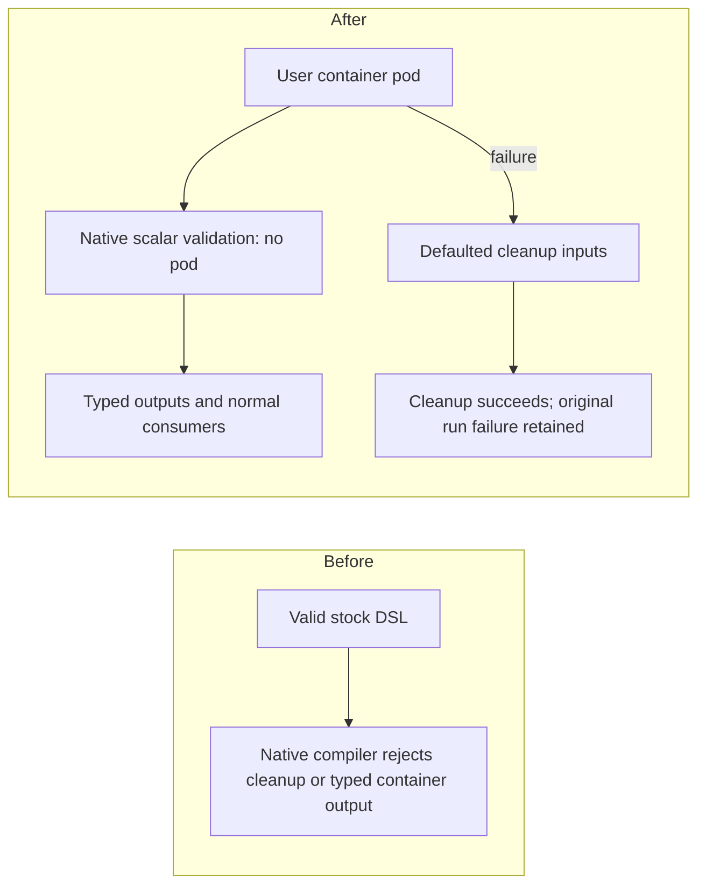
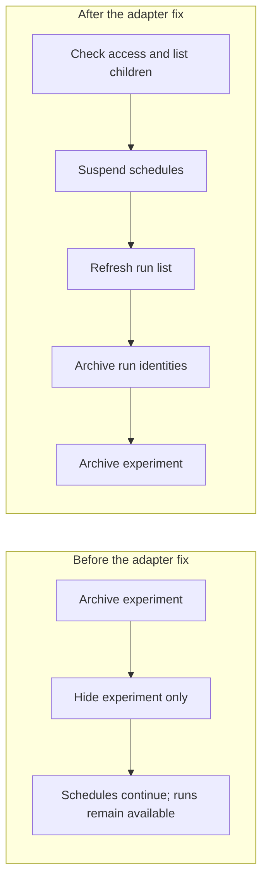

# SDK and UI backwards-compatibility contract

**2026-11-20 checkpoint:** implementation is paused at the user's request. The
[comprehensive inventory](compatibility.md) is authoritative for confirmed gaps,
limits and uncertain coverage. References below to blocked/outage-era tests explain
why those tests remain unrun; the latest Kubernetes health probe recovered, but no
interrupted live validation was resumed. Earlier live passes are historical evidence,
not a claim that all current code has passed deployment acceptance.

## Required behavior

The reference is stock commit `7780f12acfbde9f16169c7fcbfdfb6c3ef5432ea`.
The user-facing SDK and UI must remain compatible when execution moves to Argo.
This requirement supersedes the earlier bounded-prototype contract. The existing
feature-gap inventory describes implementation gaps, not permission to remove
those features.

The acceptance target is user-facing behavior, not matching internal machinery:
existing Python DSL must compile and execute, and the UI should look as similar
to stock as possible. The stock `samples/` directory is a concrete regression
corpus. Internal protocols, bookkeeping and connection paths may change.

Explicit exceptions agreed with the user:

- Compiled pipeline manifests are native Argo resources, not PipelineSpec IR.
  Reading/manipulating historical execution IR and emitting KFP PipelineVersion
  CRDs are not compatibility requirements.
- The backend REST/gRPC wire contract need not match KFP's old endpoints.
- Local execution remains removed, as explicitly reconfirmed by the user.
- Recurring-run catch-up uses native Argo semantics: at most one missed occurrence
  is recovered within the configured recovery window. The user explicitly accepted
  this exception. No custom backfill dispatcher or Argo engine changes are required.

Argo Workflows itself must remain unmodified (explicit user decision). Use existing
native resources; surface any genuinely unrepresentable behavior for a specific
user decision rather than silently approximating it. The single-occurrence catch-up
exception above is already approved; other differences still need explicit review.

Everything else is presumed part of the compatibility target unless an exception
is agreed explicitly. In particular, a convenience method, setting or public
return object is not IR-specific just because its old implementation used IR.

## Required surfaces and current work

| Surface | Required contract | Current status / remaining work |
|---|---|---|
| `kfp.Client` / `kfp.client.Client` | Same constructor, methods, defaults, public return fields and exceptions; namespace, auth, pagination and filtering behavior retained | Facade, credential helpers and response models restored. Basic experiment, pipeline/version, run and recurring operations implemented; broader authentication, model details and compiler/runtime behavior still need validation |
| Decorators and component definitions | Existing component/pipeline/container/notebook declarations, imports, defaults, typed values and component-loading helpers remain usable | Common declarations are retained; runtime and unsupported lowering must be completed |
| Compilation | Ordinary `Compiler().compile(...)` calls work without new mandatory options | Default components now compile without new image/package/cache requirements. Several advanced constructs/settings remain rejected |
| Caching | Enabled by default; task/global overrides and custom keys preserve behavior | Compile-level regressions pass for ordinary decorators, mutable tags/packages/external settings, repeated calls, pipeline scope and custom-key overrides; arbitrary one-hour expiry removed. A real unchanged two-task SDK program succeeds twice, with two pods initially and zero new pods on the cached run |
| Control flow | Conditions, OneOf, nested pipelines/loops, scalar/artifact collection, explicit dependencies and failure handling | Conditions, nested loops, scalar/artifact OneOf, returned artifact collections and exit-handler samples compile/run. Failure-tolerant cleanup supports defaulted parameters, optional artifacts and final-status inputs, including within a conditional group. Dynamic artifact lists now stage into Python consumers through an init-container, including cached, empty and nested collections. Explicit-command container list consumers now use Argo's argument-file mechanism. Artifact-list iteration has compiler/runtime support and offline native validation, but execution verification is blocked by the local cluster outage. Cross-boundary failure-tolerant inputs and entrypoint-only list consumers remain incomplete |
| Artifacts and storage | Importers, root artifacts, typed outputs, metadata, configured pipeline roots and previews | S3/GCS root bindings and automatic previews are implemented; all four stock preview/list samples execute with downloaded preview validation. Native importers preserve external references, dynamic metadata, reimport and cache behavior; S3 execution is verified. Root artifact inputs and additional storage/workspace modes remain incomplete |
| Runtime and task settings | Existing Python/container images, parameter types, retries, dynamic settings, task configuration and supported Kubernetes modifiers | Embedded bridge now runs with unmodified PyPI KFP 2.17.0 and default component images. Dynamic resource bindings and native PVC tasks are implemented. Raw-container integer, float, boolean, list and dictionary outputs now use native validation without additional pods; malformed values fail the component and run. Fractional retry factors and other rejected settings remain incomplete |
| Submission and management | Upload/package helpers, create-run conveniences, experiments, archive/restore/delete, schedules, polling and notebook links | Native adapters must preserve the SDK facade and UI actions, not expose engine-specific workarounds |
| Recurring runs | Same enabled default, interval/cron triggers, dates and concurrency; accepted native catch-up exception | Client creation/list/get/enable/disable/delete now use CronWorkflows, including interval descriptors and date guards. Default enabled state restored. Limits above one use native Workflow semaphores; queued workflows are an Argo implementation detail. Stock trigger editing and SDK→UI clone→SDK configuration round trips pass; scheduling edge cases still need review |
| Other public entrypoints | Deprecated aliases, credentials, registry helpers and non-IR CLI operations remain available | Management CLI, completion/plurals, diagnostics and registry restored; deprecated v2 aliases verified |
| UI | Same user workflows, selectors, metadata and visualizations over native resources | UID/name interoperability, shared pipeline records and reversible run/experiment archival are implemented. Authenticated SDK→UI→SDK checks pass. Custom roots, trigger editing, Dataset/Model previews, ROC curves and confusion matrices use stock presentation. Compiler-generated validation nodes remain inside the user component; component errors and actual pod logs remain accessible. Broader discovery and visualization coverage still need review |

## Implementation boundaries

- Argo remains the execution source of truth. Do not restore KFP API services,
  execution controllers, driver pods, or the execution IR compiler.
- Keep native transport behind the SDK and UI. Users should not have to construct
  Workflows, discover WorkflowTemplate names or manage ConfigMaps themselves.
- SDK-facing response models are distinct from the old server wire protocol.
  Preserve public attributes and useful serialization without reintroducing old
  endpoint dependencies.
- SDK and UI must agree on native identities, metadata, archival state and schedule
  configuration. Deleting a grouping must not accidentally garbage-collect runs.
- Do not silently drop unsupported settings, switch caching off or replace a
  requested behavior with a successful no-op. Unimplemented behavior remains an
  outstanding compatibility defect, not a completed adapter.

## Verification standard

1. Freeze public signatures/defaults and representative unchanged user programs
   from the stock baseline before implementation.
2. Exercise authoring, compilation, public Client calls and return objects through
   black-box tests. Wire-level expectations may change; public assertions must not
   be weakened to fit the native implementation.
3. Run unchanged user programs on a real native deployment. Include default
   lightweight components with caching on, typed artifacts, control flow, runtime
   settings, authenticated Client/UI lifecycle, and repeated execution/cache hits.
4. Test failure behavior, authorization, retries, name reuse, pagination and data
   preservation, not only successful submissions.
5. Keep the existing native regression suites as additional coverage. Their
   passing count alone is not evidence of full stock SDK compatibility.

Initial evidence: the frozen 65 calling conventions plus the top-level Client alias
check found 44 failures and 22 passes. All 66 calling-convention checks now pass,
but signature compatibility is not behavioral compatibility. The current Python
suite includes restored credential tests, native HTTP-boundary Client tests and
stock-sample regressions. It does not yet exercise every stock contract.

Runtime regression evidence:

- The compiled-command test initially found the unsupported stock
  `python3 -m kfp.dsl.executor_main` invocation; it now verifies the embedded
  native entrypoint. A subprocess test blocks importing the fork's runtime module
  and still executes the embedded bridge successfully.
- An executor-constructor regression initially failed because the older runtime
  did not accept `artifact_previews`; the bridge now handles that constructor.
- `test/e2e/stock_runtime.py` checks typed parameters, a staged
  Dataset, metadata and URI against an unmodified PyPI KFP installation.
- `test/e2e/test_default_pipeline.py` uses ordinary decorators and
  `Client.create_run_from_pipeline_func`, with no image or compiler workaround.
  On OrbStack both runs succeeded; native status showed two cache misses/two pods
  initially and two cache hits/zero new pods on the second run.

```sh
uv run python test/e2e/stock_runtime.py prepare /tmp/kfp-stock-runtime
uv run --no-project --python 3.11 --with kfp==2.17.0 python -I \
  test/e2e/stock_runtime.py run /tmp/kfp-stock-runtime
```

### Stock sample evidence

`test/e2e/corpus.py` preserves pipeline/component bodies and
compiles definitions without executing notebook install/submission/timing cells.
The actual stock SDK compiled 27 of 29 definitions; the initial native pass compiled
22. The five migration regressions now have native lowering and retained tests in
`test/stock_samples_test.py`. Two failures also occur with stock: the environment
validation notebook has missing imports/stale names, and the parallel-join sample
uses an unsupported empty container decorator call.

`test/e2e/test_samples.py` separately records execution and semantic
checks. The per-sample results of the latest complete `samples/core` pass are in
[core samples](core-samples.md): 25 of the 27 baseline-compilable definitions pass
on OrbStack (three after fixes made during that pass), including all four
preview/list samples, directory/file data passing, control flow, retries and PVC
lifecycle. Response-field parity for runs, tasks, experiments and schedules is
tabulated in [the compatibility inventory](compatibility.md#field-level-response-parity-resolved-2026-11-20).
GPU and credentialed-cloud execution are
not verified. Caching/memory sample runs use explicitly recorded smaller inputs;
this is not a claim that every original notebook timing/submission cell ran.

### Failure handling and container output evidence

`test/e2e/test_ignore_failure.py` verifies both successful and failed
upstream execution, declared scalar defaults, optional `None` versus the literal
string `"null"`, optional Dataset inputs, and `PipelineTaskFinalStatus`. It checks
that cleanup succeeds while the failed run stays failed, including inside a
conditional group. The compiler regressions originally failed on explicit
`ignore_upstream_failure()` rejection. Argo also checks missing references before
ternary evaluation: fallback expressions must guard absent outputs with `??`.
Optional artifact references are resolved at Argo's optional-artifact stage.

`test/e2e/test_container_scalars.py` verifies all five non-string scalar
types, Dataset forwarding, cache reuse, and malformed integer/boolean/list output
failures. The ordinary container command and image are unchanged. A native DAG
and zero-duration suspend control node validate its output; no additional pod,
launcher or execution service is introduced. Validation runs before cache storage.
Doing validation only in DAG output expressions was insufficient: an errored DAG
could lack outbound edges and leave its enclosing workflow running. The connected
validation node makes those failures terminal without modifying Argo.



Run the retained compiler/runtime regressions with:

```sh
uv run --python 3.11 --isolated --frozen --extra test python -m pytest -q \
  sdk/python/kfp/compiler/argo_compiler_test.py sdk/python/kfp/dsl/argo_runtime_test.py
```

The live programs require `KFP_TEST_TOKEN` and optionally `KFP_TEST_HOST` and
`KFP_TEST_NAMESPACE`. They retain their runs and artifacts. The read-only browser
check `frontend/e2e/component-wrapper.test.mjs` verifies the component's
error, task presentation and underlying pod-log access. These checks do not prove
all cross-group continuation cases, retry combinations or workspace modes.

### Optional parameters and source loading

Nullable parameter carriers distinguish `None`, the literal string `"null"`, and
`""`. Public SDK arguments and response values remain ordinary Python values. Live
checks cover omitted defaults, nested forwarding, `OneOf`, conditions, fallback
defaults and quoted/interpolated strings. UI controls explicitly select None and
render decoded values instead of exposing the wire encoding.

Raw-container `IfPresent` and nested `Concat` now lower to native argument-array
expressions. None selects the absent branch; empty strings and literal `"null"`
remain present. This adds neither a pod nor a runtime to the user image. It also
composes with artifact-list staging's argument file and preserves other pod-patch
settings. The BusyBox fixture in
`test/e2e/test_container_optional_inputs.py` covers ordinary and staged
consumers, including empty artifact collections. Compiler regressions, native
offline lint and 25 pinned-expression evaluations pass; live execution is still
blocked by the local cluster outage. Nullable Kubernetes settings need further
coverage/lowering.

The CLI loads the exact requested Python path in a separate module namespace and
reads current source bytes, rather than reusing a same-basename import or stale
bytecode. The regression uses two different `components.py` files and checks that
existing modules and `sys.path` are preserved.

### Workspaces, TaskConfig and Kubernetes settings

Explicit workspace PVC specs now lower to native `volumeClaimTemplates`. The
workspace placeholder resolves to `/kfp-workspace`, and pod patches mount the claim
only for tasks whose user inputs reference that path. Automatic cache keys include
run identity for those tasks, matching the stock cache's use of resolved PVC names;
unrelated tasks retain cross-run cache reuse. `test/e2e/test_workspace.py`
verifies file sharing, a path returned at runtime, unrelated/no-input tasks, two-run
cache behavior and the absence of mounts on unrelated pods. Deployment-provided
workspace access-mode defaults and workspace importer downloads remain unfinished.

`TaskConfig` passthroughs now project selected native settings and honor
`apply_to_task`. This avoids allocating external-workload resources or applying
external-only selectors to the component pod. Runtime identity environment variables
stay on the component. Task-local emptyDir/ephemeral volumes are not forwarded as
shared volumes. `test/e2e/test_task_config.py` checks dynamic CPU, environment
and node-selector projection with unchanged public annotations and no driver pod.
Python workspace-volume passthrough now preserves the actual run's claim identity
without mounting it on an external-only task. Unused workspace context remains
cacheable across runs. Dynamic node-selector/toleration/single-affinity JSON also
works in native pod patches and Python TaskConfig; mixed dynamic affinity terms,
mixed dynamic claim declarations and raw-container structured TaskConfig remain incomplete.
Dynamic claim Pod fields and external-only claim projection have been verified without
claiming successful device allocation on this cluster.

`test/e2e/test_kubernetes_settings.py` verifies user init-containers,
emptyDir sharing, dynamic ConfigMap environment/volume names, downward API values,
non-root identity, capability dropping, privilege-escalation prevention, seccomp,
affinity and toleration seconds on the actual pod. Static DRA mapping is tested at
the manifest boundary only; no device-allocation claim is made.

`Client.get_run()` now projects available native task states, cache state, hierarchy,
typed parameters and artifact identities into the generated public response models.
It does not fabricate missing metadata, historical Pod UIDs/state transitions or
MLMD context IDs. Certificate-only reads with offloaded node data still lack those
Argo-only details rather than incorrectly reporting an empty task list.

Markdown artifacts now use the stock renderer and installed parser. Scoped document
styles restore list markers/table spacing under the application's CSS reset. Raw
HTML is disabled and link URLs are sanitized by the parser, as in stock; remote
images load as written. `frontend/e2e/markdown.test.mjs` verifies formatting, the
absence of script execution and the stock image behavior against a real produced
artifact.

### Artifact-list staging

Python consumers of `dsl.Collected` artifact lists receive local files or
directories, metadata, original URIs and producer identities. A staging
init-container in the consumer pod uses Argo's existing artifact downloader; it
adds no copy pods, backend service or controller. The adapter uses the standard
library in `python:3.11` and the executor binary already installed by the pinned
Argo deployment, rather than a separate storage SDK or custom image.

SDK and UI submissions bind the namespace's Argo artifact-repository configuration
onto a copy of the workflow. They read ConfigMaps and project Secret **references**;
they do not retrieve Secret values. The new Secret mounts belong only to the
staging init-container. The user's container receives the staged data volume, not
storage credentials. Immutable stored pipeline versions remain unchanged.

Argo first writes collection parameters as a raw input artifact. Both the staging
adapter and Python bridge read that file, avoiding process-argument size limits.
The staging executor has a private working directory and reads the real executor
binary through a read-only mount, so it cannot overwrite the main executor's
bootstrap files. Large templates use Argo's native ConfigMap offload. The deployment
grants the controller namespace-scoped ConfigMap **create** permission for this;
component service accounts and reader mutation permissions remain unchanged.

`test/e2e/test_artifact_lists.py` covers files, directories, original cached
sources, empty lists, nested loops/conditions/pipelines, HTTPS imports and missing
objects. A 256-artifact cached-source run succeeded with just one new consumer pod.
`frontend/e2e/artifact-list.test.mjs` verifies UI submission, successful
execution and immutable version storage. An SDK-created recurring run also completed
with staging; its test schedule was then disabled.

Explicit-command container consumers can also receive whole-list JSON with the
stock camel-case artifact schema, original URI/metadata and staged `customPath`.
The init-container prepares an argument file for Argo's existing emissary; the user
image needs no Python or shell beyond its own command. A BusyBox-only consumer,
files, directories, empty lists and downstream report artifacts are verified.
Single arguments must remain below the process argument-size limit, and
entrypoint-only container list consumers remain unsupported.

Iteration over a list returned by a nested pipeline now routes each artifact's
identity into its consumer's staging init-container. Nested artifact collections
are flattened at loop boundaries; empty loops expose empty output collections.
Compiler/stager tests and the pinned Argo CLI's offline validation pass, including
nested forwarding. The live iteration fixture remains unverified because the local
Kubernetes API became unreachable before submission.

Current provider boundaries are S3, GCS and HTTP(S). GCS configuration is unit-tested
but has not been cloud-execution verified. Repository plugins and OCI/modelcar
sources still need work.
The integration is verified against the pinned regular Argo executor layout, not
all alternative/init-less executor configurations. Direct Argo submissions of
compiled list consumers must bind their repository configuration; the public SDK
and UI perform that binding automatically.

### Experiment archive lifecycle

SDK and UI experiment archival now disable associated recurring runs and logically
archive their runs before hiding the experiment. Live workflows are not terminated;
artifacts, SQL archive records and PVCs are not deleted. A second run listing after
schedule suspension includes runs created while those requests were in flight.
Restoring an experiment leaves its runs archived and schedules disabled. Restoring
an individual run first requires its experiment to be available.



These are ordered Kubernetes operations, not a cross-resource transaction. The
experiment update is sent only after child operations succeed. Some children may
already have changed when an error is reported. Repeating the operation converges without
resuming schedules or recreating runs. This does not provide an atomic boundary
against concurrent schedule/run creation. Access to Argo's archive listing remains
necessary to include runs no longer represented by live Workflow resources.

Regressions in `test/native_client_test.py` and `frontend/src/lib/NativeUi.test.ts`
cover child selection, active and SQL-only runs, original resource identities,
permission failures, retry, restoration, and runs created during suspension. These
checks pass offline; live verification of this change is blocked by the current
local Kubernetes outage. The production-bundle browser test uses explicit API
fixtures to verify the confirmation, schedule count refresh, archived run view,
and restore behavior. Experiment details refresh child inventories even after a
partial failure and preserve explicit tab choices. The archived-experiments page
uses the stock two-column, refresh-only layout and nonselectable archived run
expansions, without a duplicate experiment column or nested filter bar.

### SDK task snapshots

Native task responses preserve typed inputs/outputs, cache origin, hierarchy and
execution pod names, including nested retry/validation wrappers. Default gzip
node-status compression is decoded locally, so direct Kubernetes authentication
does not require an Argo authentication bridge for those snapshots. Expansion is
bounded to 64 MiB; malformed or oversized gzip data fails explicitly.

SQL-offloaded status and alternative Argo compression codecs still require a
hydrated Argo response. When no supported node inventory is available, `tasks`
and `task_count` are `None`, not an empty successful inventory. Missing MLMD IDs
and historical transitions are not invented. These remaining adapter gaps are
not inherent limits on implementing the public SDK behavior.

### Inventory polling

The UI requests projected Argo metadata/status summaries rather than polling full
workflow templates and node inventories. A Kubernetes metadata-only UID index
preserves physical live-resource identity: Argo can list a SQL summary even while
an `Archived`-labelled Workflow still exists. Live summary data wins over SQL
duplicates, and newly created identities are retained while Argo's cache catches
up. Graph, clone and artifact views still fetch the selected full workflow.

Combined Argo live/SQL pagination requests its remaining-item count. The UI still
collects all summary pages for its existing client-side filtering; this is not a
claim of server-side table pagination. SDK cold UID lookup likewise requests
metadata only before fetching the selected workflow. Warm lookup caches the route,
never the workflow state. Authentication and namespace/RBAC boundaries are unchanged.
These paths have offline regression coverage; live response-size and compatibility
verification remain blocked by the local cluster outage.

### Kubernetes authentication

`Client(kube_context=..., namespace=...)` uses the selected kubeconfig credentials
directly for Kubernetes core and Argo resource APIs. Both client certificates and
service-account tokens have been verified by compiling, submitting and waiting for
an unchanged stock sample. In-cluster configuration uses the mounted Kubernetes
service-account credentials and preserves refresh hooks. An explicit
`existing_token` selects that identity without also presenting a kubeconfig client
certificate. Reader-token authorization was verified without an admin fallback.

No authentication bridge is introduced just to preserve the old connection path.
Engine-only routes, meaning the archive, go to Argo Server itself with the same
Kubernetes token (`Client(argo_server=...)`, the Argo CLI's `ARGO_SERVER` family,
or the in-cluster `argo-server` Service); Argo Server's client auth mode accepts it
directly, so the UI proxy is not part of the SDK path. A certificate-only
kubeconfig has no token Argo Server can use and may set `ARGO_TOKEN`; without any
address outside a cluster, listings warn once and cover live runs. The UI/proxy
`host=...` connection remains available for people without a kubeconfig.

Reproducer: `test/e2e/test_kube_context.py --context orbstack
--namespace kfp-argo --run`, or add `--service-account-token` with `KFP_TEST_TOKEN`.
It neither prints credentials nor modifies the user's SDK context file.

### Accepted scheduling behavior

`no_catchup=True` maps to `startingDeadlineSeconds: 0`. Otherwise the SDK uses a
long, duration-safe recovery window of 2,147,483,647 seconds, avoiding an additional
short cutoff; unmodified Argo still creates at most one recovery run. There is no
custom backfill dispatcher. Native semaphores limit running workflows when
`max_concurrency > 1`; Argo may retain waiting workflows while permits are occupied.

`test/e2e/test_recurring.py` verifies default-enabled creation, disabling,
re-enabling and an actual scheduled Workflow using public SDK methods. It leaves
its owned schedule disabled. An additional disabled three-permit schedule with
start/end dates was accepted by the real Argo API. Full outage/recovery scenarios
remain separate from the documented engine semantics.

Status: implementation paused for inventory and commit. Full backwards compatibility
is **not established**. See the inventory for accepted departures, confirmed gaps,
known limits, unverified cases and the remaining validation work.
