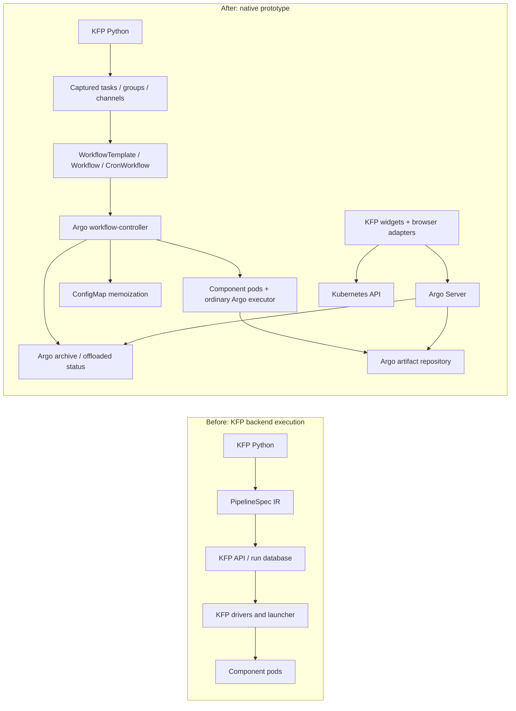

# Native Argo prototype

This fork captures the KFP Python DSL and compiles ordinary Argo resources. It does
not call the KFP IR builder on that path. Python components use a small bridge in
their own container; Argo schedules tasks, transfers artifacts, memoizes outputs
and records status. There are no KFP API, driver, scheduler or metadata services in
the deployment.

The UI retains KFP's sidebar, toolbars, tables, upload/run forms, selectors, graph,
artifact cards, inspector, timeline and log widgets. Its browser adapters talk to
Argo Server and Kubernetes, not recreated KFP endpoints.
It supports pipeline versions, experiments, submissions, schedules, live/archived
run details, typed artifacts, input lineage, selected-run metrics and run actions.

## Local deployment

The deployed target is Kubernetes context `orbstack`, namespace `kfp-argo`.
Use a disposable, single-user namespace. The upstream quick-start has development
object-store/database credentials; Argo's internal certificate is self-signed.
The UI requires a namespace-scoped token, but this is **not a production or
multi-tenant installation**. Keep the port-forward on loopback.

Requirements: OrbStack Kubernetes, Docker, kubectl, Argo CLI, uv, and the Node/npm
versions pinned in `frontend/.nvmrc` and `frontend/package.json`.

From the repository root:

```sh
orbctl start k8s
uv build --package kfp --wheel
docker build -f samples/argo-native/Dockerfile -t kfp-argo-demo:dev .

cd frontend
npm ci
npm run build
cd ..
docker build -f samples/argo-native/Dockerfile.ui -t kfp-argo-ui:dev .

uv run python samples/argo-native/deploy.py > /tmp/kfp-argo-deployment.yaml
kubectl --context orbstack -n kfp-argo apply --server-side -f /tmp/kfp-argo-deployment.yaml
kubectl --context orbstack -n kfp-argo rollout status deploy/postgres
kubectl --context orbstack -n kfp-argo rollout status deploy/minio
kubectl --context orbstack -n kfp-argo rollout status deploy/workflow-controller
kubectl --context orbstack -n kfp-argo rollout status deploy/argo-server
kubectl --context orbstack -n kfp-argo rollout status deploy/kfp-argo-ui
```

`deploy.py` uses `third_party/argo/VERSION` (verified with v4.1.6), PostgreSQL
archive/node-status offloading, and PVCs for SQL and object-store data. It configures
Argo **client** authentication, namespace-scoped editor/reader roles, and a static
Nginx UI/proxy with no Kubernetes privileges of its own. No browser token is built
into the image, put in a URL, or stored in browser storage.

Keep this running:

```sh
kubectl --context orbstack -n kfp-argo port-forward svc/kfp-argo-ui 3003:80
```

Open <http://127.0.0.1:3003/argo.html?namespace=kfp-argo>. Generate a token for the
login field. On macOS, copy it without printing it:

```sh
kubectl --context orbstack -n kfp-argo create token argo-ui-editor --duration=2h | pbcopy
```

Use `argo-ui-reader` instead to test denied mutations. These are namespace roles,
not cluster-admin credentials. Tokens are cleared when the UI reloads. Restart a
port-forward after its target pod is replaced; a stale forward can keep its port
bound until its next request detects that the old pod is gone.

### Single-user mode (no login)

For a disposable local namespace, generate the deployment with
`--auth-mode single-user` instead:

```sh
uv run python samples/argo-native/deploy.py --auth-mode single-user > /tmp/kfp-argo-deployment.yaml
kubectl --context orbstack -n kfp-argo apply --server-side -f /tmp/kfp-argo-deployment.yaml
kubectl --context orbstack -n kfp-argo rollout status deploy/kfp-argo-ui
```

This is the counterpart of stock KFP's standalone (non multi-user) deployment. The
proxy is bound to the `argo-ui-read` and `argo-ui-edit` roles, authenticates every
`/argo/` and `/kubernetes/` request with its own projected service-account token
(read per request, so rotation needs no restart), ignores any browser
`Authorization` header, and publishes `{"authMode":"single-user","namespace":"kfp-argo"}`
at `/config.json`. The UI reads that endpoint on load, skips the token dialog and
defaults to that namespace, so <http://127.0.0.1:3003/> works without a
`?namespace=` query (an explicit `?namespace=` still wins). The deployment smoke
test and its denied-mutation checks need the default `token` mode.
Do not use single-user mode on a shared cluster: anyone who can reach the
port-forward has editor rights in the namespace.

## Compile and submit

`components.py` is the dataset → model → metrics example. The ordinary
`compiler.Compiler().compile(...)` entrypoint defaults to a content-addressed
`WorkflowTemplate`; `resource_kind='Workflow'` creates a standalone run and
`resource_kind='CronWorkflow', schedule='0 9 * * *'` creates a suspended schedule.

For the local example:

```sh
uv run python samples/argo-native/compile_demo.py --output /tmp/native-pipeline.yaml
kubectl --context orbstack -n kfp-argo apply -f /tmp/native-pipeline.yaml
```

The helper verifies the Docker image ID and creates a `kfp-<sha256>` image tag,
refusing to overwrite a conflicting snapshot. `Compiler(image_digests={...})`
uses that content-named local reference, so later rebuilds of `:dev` do not change
an existing version's image. For registry images, use an actual immutable digest
in `base_image`. Kubernetes does not itself enforce tag or WorkflowTemplate
immutability; do not mutate content-named resources outside this convention.

Use **Pipelines → Upload pipeline** to upload a compiled WorkflowTemplate YAML
file. Expand a pipeline row or use its graph's **Show Summary** card to select a
version. **Create run** opens the normal run form with parameters, an experiment
selector and one-off/recurring choices. Recurring runs create suspended
CronWorkflows; enable them from their details page. Versions are create-only;
the editor role cannot update them. Experiments are ConfigMaps, and membership is
a label rather than an owner reference.

**Runs → Active / Archived** separates live Workflow CRs from archive-only records.
**Archive** verifies SQL persistence before deleting a completed live Workflow and
its pods. Its artifacts and logs remain accessible by UID. **Restore**, experiment
archival and namespace metadata transfer are explicitly unavailable. Experiment
ConfigMap deletion remains a Kubernetes operation, not a custom UI button.

The CLI also supports native output:

```sh
uv run kfp dsl compile --py samples/argo-native/components.py \
  --output /tmp/uncached-run.yaml --resource-kind Workflow \
  --namespace kfp-argo --disable-caching
uv run kfp visualize samples/argo-native/components.py --format both -o /tmp/pipeline.html
```

Python previews disable caching while projecting the graph, so they do not need
registry access or deployment image identities. They do not submit a run. Native
HTML exports retain nested graph expansion, artifact cards and the JSON inspector.

### Argo CLI with offloaded status

Use Argo Server rather than direct Kubernetes mode to inspect offloaded nodes:

```sh
export ARGO_SERVER=127.0.0.1:3003
export ARGO_BASE_HREF=/argo
export ARGO_HTTP1=true
export ARGO_SECURE=false
export ARGO_TOKEN="Bearer $(kubectl --context orbstack -n kfp-argo create token argo-ui-editor --duration=2h)"
argo list -n kfp-argo
argo submit -n kfp-argo --from workflowtemplate/NAME_FROM_NATIVE_PIPELINE_YAML --watch
```

Direct `kubectl` remains useful for resources, but its raw Workflow status need not
contain nodes. The deployment deliberately enables node-status offloading to test
this boundary.

## Runtime and cache contract

`--argo_input` is static `kfp-argo/v1` port configuration. Argo supplies parameter
values separately with `--argo_parameters '{{inputs.parameters}}'`; artifact-list
consumers use a native raw input file to avoid process-argument size limits. User
strings cannot alter the static contract. The embedded bridge invokes KFP's Python
`Executor` against staged paths, including ordinary upstream SDK installations, and
writes scalar outputs and metadata files for Argo to capture.

Artifact payloads have actual S3 identities containing the workflow UID and pod
name. Full Python metadata and task summaries are Argo artifacts, with distinct
local paths and S3 keys. Only small producer/type/URI identities are put in workflow
parameters. A 100 KB metadata test verifies that downstream Python receives the
whole metadata object without putting it in workflow parameters. Native container
components can supply a small static metadata companion inline; missing required
Python metadata fails instead of inventing empty metadata.

Automatic cache keys include pipeline/component identity, execution configuration,
resolved parameter strings and artifact identities. Caching is enabled by default;
ordinary image tags, runtime installations and external Kubernetes settings are
accepted. Version mutable dependencies or explicitly disable caching when freshness
matters. Custom keys intentionally override automatic input identity. There is no
arbitrary one-hour expiry; cached metadata retains its original producer, and cached
artifact data must remain available.

Python artifact-list consumers add a staging init-container, not another pod. It
uses Argo's installed downloader and receives repository Secret mounts separately
from the user container. SDK/UI submission binds namespace repository configuration
without reading Secret values or altering stored versions. Large-template offload
requires the controller's ConfigMap-create Role; component service accounts remain
unchanged. See [SDK compatibility](../../docs/sdk-compatibility.md) for staging
coverage and remaining provider/runtime limits.

## Verification

Run the full retained Python suite on both supported versions:

```sh
uv run --frozen --extra test python -m pytest -q sdk/python/kfp test
# Repeat with: uv run --python 3.11 --isolated --frozen --extra test python -m pytest ...
```

`bash test/native-deployment.sh` performs the complete build/deploy/acceptance flow
in a new disposable Kind cluster: it deploys, runs the live suite under `test/e2e/`
in parallel (everything but prerequisite cases), then the browser acceptance test. It does not operate on
the existing OrbStack stack.

Against this OrbStack stack, run the live suite directly through the UI port-forward
(see [testing](../../docs/agents/testing.md) for tiers and settings):

```sh
export KFP_TEST_HOST=http://127.0.0.1:3003 KFP_TEST_NAMESPACE=kfp-argo
export KFP_TEST_TOKEN="$(kubectl --context orbstack -n kfp-argo create token argo-ui-editor --duration=2h)"
KFP_TEST_IMAGE=kfp-argo-demo:dev uv run python -m pytest test/e2e -m smoke -p no:randomly
```

`test_control_flow.py` carries the nine control-flow cases that used to be a separate
corpus: nested DAGs, both conditional branches, bounded loops and integer collection,
failed loop iterations, successful/failing bodies and failing cleanup, a native
container artifact crossing a nested pipeline boundary, large metadata transfer, and
actual retry attempts with pod resource requests/limits. Deliberate failures are
asserted, not retried into success.

For the deployed browser test, supply a compiled WorkflowTemplate name as the base.
It creates a new version with isolated cache keys rather than clearing existing
cache data:

```sh
cd frontend
ARGO_EDITOR_TOKEN="$(kubectl --context orbstack -n kfp-argo create token argo-ui-editor --duration=2h)" \
ARGO_READER_TOKEN="$(kubectl --context orbstack -n kfp-argo create token argo-ui-reader --duration=2h)" \
ARGO_VERSION_NAME=YOUR_COMPILED_WORKFLOW_TEMPLATE \
npm run test:e2e && node --test e2e/deployment.test.mjs
```

This uses a fresh headless Chrome context and real APIs. It verifies UI upload and
submission, image identity, three task pods followed by two on cache reuse, both
scores, artifact download, logs, offloaded status, a native approval gate, denied
Kubernetes/Argo mutations, CronWorkflow persistence and CLI changes, archive access
after the UI's Archive action, non-cascading experiment deletion through Kubernetes,
and SQL/object-store data after a full stack restart. It leaves its named test
resources for inspection.

Argo 4.1.6 can retain a closed SQL session after PostgreSQL restarts. If archive
requests report `session proxy is closed`, recover the stateless services:

```sh
kubectl --context orbstack -n kfp-argo rollout restart deployment/argo-server deployment/workflow-controller
kubectl --context orbstack -n kfp-argo rollout status deployment/argo-server
kubectl --context orbstack -n kfp-argo rollout status deployment/workflow-controller
```

This does not delete Workflows, SQL rows, artifacts or PVCs. The persistence test
performs this recovery explicitly; automatic database reconnection and HA are
not established.

Evidence is written to `/tmp/kfp-argo-deployment-evidence.json` and screenshots to
`/tmp/kfp-argo-{deployed-runs,denied,archived}.png`. Do not publish tokens or raw
browser traces containing authorization headers.

## Scope and remaining compatibility limits

Compatibility implementation is still in progress. Native importers, scalar/artifact
OneOf, Python and explicit-command container artifact-list consumers, typed container
outputs, nullable parameters, explicit-spec workspaces, TaskConfig projection and
native Kubernetes settings now have execution evidence. Remaining gaps include root
artifact arguments, workspace deployment defaults/importer downloads, entrypoint-only
list consumers, artifact-list iteration, some continuation/nested-setting combinations
and unverified Kubernetes/cloud extensions. Task-final-status verification covers success and failure, not every
legacy cancellation/error-code semantic. The embedded bridge preserves ordinary
component images and has been tested with unmodified PyPI KFP 2.17.0.

The [working inventory](../../docs/compatibility.md) distinguishes accepted changes,
implemented behavior, unfinished adapters and unverified deployment prerequisites;
none of those test results establish complete upstream SDK/UI compatibility.

The KFP backend, REST clients, old pipeline IR compiler, Node server and their
integration/serialization tests have been retired. Stock presentation components
are retained with native data adapters; the stripped-down prototype pages are removed. The full retained SDK and native
UI suites are the validation target; retired APIs are not silently emulated. A small
container-definition serializer and shared authoring/configuration schemas remain
for SDK loading and image building. The Docker Python dependency is used for image
building. See [the stock-KFP feature gap inventory](../../docs/compatibility.md).

Resource discovery follows native continuation tokens; table search, sorting and
pagination operate on the namespace inventory in the browser. The global artifact
list covers the 50 most recent runs, with an explicit truncation notice, and
comparison is limited to five selected runs. Lineage is derived from declared task
inputs/outputs and producer metadata. There is no global artifact index, migration service, new
application backend or custom controller. The handwritten workflow remains a
runtime-contract fixture. The obsolete Stage A installer is removed; `deploy.py`
is the only deployment generator, and unused upstream demo services are filtered out.

<details>
<summary>Failure fixes and architecture evidence</summary>

- The interrupted Stage A setup used a retired MinIO image and lacked scoped cache
  update permission. The obsolete installer is now retired; the current deployment
  and its tests use the repository Argo pin and scoped cache permissions.
- Exit-handler verification caught successful cleanup masking a failed body. Both
  `body` and `exit` are now explicit Argo DAG targets, with failure-aware dependency
  expressions. No extra control pod is introduced.
- Argo 4 rejects the old singular `spec.schedule`; SDK/UI now emit `spec.schedules`.
- The retry test caught Argo rejecting the string factor `2.0`. Integral factors
  are now normalized to integer strings, duration aliases use the SDK's existing
  normalizer, and unsupported fractional factors fail compilation.
- Read-only log access also requires pod-watch permission; mutations remain denied.
- Argo 4 includes persisted SQL rows in its workflow list. The browser recognizes
  them and retrieves artifacts/logs by archive UID, including after CR deletion.
- Regression tests cover parameter types/non-finite JSON, malformed metadata,
  same-name replacement checks, metadata path/key collisions, large metadata,
  mutable cache inputs and rejection of unresolved dynamic execution settings.



</details>
